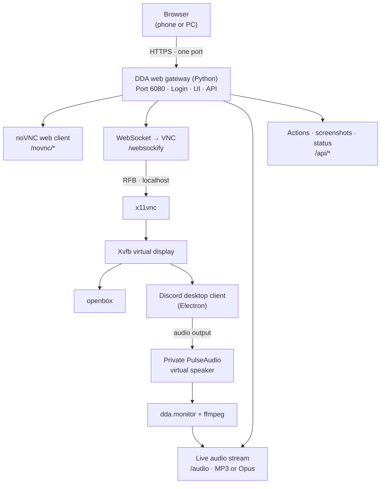

# Discord Desktop Anywhere

Run the **official Discord desktop client** (PTB by default) in your browser, **with live audio**, on Replit or any
Linux machine: a VPS, a home server, a cloud VM, a Raspberry-Pi-class box with an x86 CPU, or a plain Ubuntu/Debian
install. No Docker and no root access required.

> Independent community project. Not affiliated with Discord Inc. or Replit. See [Security and Terms](#security-and-discord-terms).

## Features

- **Audio in the browser.** Discord plays into a virtual sound card; the web UI streams it live (MP3 or Opus).
  Having a real audio device is also what lets **videos play inside Discord** (without one, Chromium stalls on video).
- **One port, one login.** Desktop, audio, control panel and API are served by a single authenticated gateway.
  Easy to put behind a reverse proxy or a Replit port mapping.
- **Runs everywhere.** Replit (Nix) and Debian/Ubuntu, Fedora/RHEL and Arch (`install.sh`). Missing noVNC is downloaded
  automatically. `doctor` tells you exactly what is missing.
- **Secure by default.** Password login with signed session cookies, brute-force limiting, CSRF and cross-site
  WebSocket protection, VNC bound to localhost, auto-generated password when you do not set one.
- **Solid process management.** Ordered start-up with readiness checks, automatic restarts with back-off, clean shutdown
  of every child process, cleanup of leftovers after a crash.
- **Phone friendly.** Floating control panel with audio, reload, Escape, 4K/8K screenshots and a screenshot gallery.
- **No Python dependencies.** The whole tool uses only the Python standard library.

## How it works

The browser connects to one gateway. The gateway serves the UI and API, forwards the VNC connection, and streams audio separately.



Everything is started and supervised by `python3 -m dda` (wrapped by `start.sh`).

## Quick start: Replit

1. Create a Repl (Blank or Bash template) and add the files of this repository to its root.
2. Open **Secrets** and add `VNC_PASSWORD` with a strong password. If you skip this, a password is generated and
   printed in the console on every start.
3. Press **Run**. The first start downloads Discord and can take several minutes; the page shows progress.
4. Open the Replit **Webview** (or the app URL in a new tab) and sign in.

`replit.nix` installs everything (Xvfb, x11vnc, openbox, PulseAudio, ffmpeg, Electron libraries). If packages seem
to be missing after the first run, close and reopen the Shell and press Run again.

> The Replit Webview pane is an embedded frame. If the login does not stick there, use **Open in a new tab**.

## Quick start: Ubuntu, Debian and other Linux

```bash
git clone https://github.com/tyowk/discord-desktop-anywhere.git
cd discord-desktop-anywhere

sudo ./install.sh          # system packages (apt / dnf / pacman); add --no-audio to skip audio
bash start.sh              # run as a normal user
```

Then open the URL printed in the console (default `http://127.0.0.1:6080/`) and sign in with the printed password.

- **Remote server?** Either tunnel (`ssh -L 6080:127.0.0.1:6080 you@server`) or set `HOST=0.0.0.0` and put a TLS
  reverse proxy in front ([examples](#reverse-proxy)). Never expose plain HTTP to the internet.
- **Check your system:** `bash start.sh doctor`
- **Run as a service:** see [`contrib/discord-desktop-anywhere.service`](contrib/discord-desktop-anywhere.service).

Supported and tested: **Ubuntu 24.04** (root and non-root). Debian and derivatives use the same code path.
Fedora/RHEL and Arch are supported on a best-effort basis (`install.sh` has package lists for them but they are not
covered by CI). Discord only ships **Linux x86_64** builds, so ARM machines are not supported.

## Using it

### Audio

Open the floating menu (bottom-right) and tap **Enable audio**. Browsers require that tap before they allow sound.

- Latency is about 1 to 3 seconds because browsers buffer streams. That is fine for videos and music; it is not suited
  for live conversation.
- If the connection drops, audio reconnects automatically. The player skips ahead when its buffer grows too large.
- `AUDIO_FORMAT=mp3` (default) plays everywhere, including iOS. `opus` uses less bandwidth at the same quality on
  desktop browsers.
- `MAX_LISTENERS` (default 3) limits simultaneous listeners; each one runs its own small `ffmpeg` process.

**Microphone / voice chat is not included**: this is output audio only (hearing videos, streams, music and voice
channels). Your Discord client sees a virtual speaker named *DDA_Virtual_Speaker*.

### Control panel

| Control | What it does |
|:--|:--|
| Enable audio / volume | Starts or stops the live stream in this browser |
| Reload / Hard reload | Reloads the Discord page (through the DevTools Protocol, key press as fallback) |
| Escape | Sends Esc to Discord |
| DevTools / Console | Only shown when `DEVTOOLS=1` |
| 4K, Full HD, 8K | Re-renders Discord at a larger scale for sharp screenshots (not a stretched image) |
| Native screen | Grabs the virtual screen as-is |

Screenshots are stored in `.discord-novnc/screenshots/` (Replit: `screenshots/` in the project) and listed in the
panel. Only the newest `MAX_SCREENSHOTS` (40) are kept.

On a phone: rotate to landscape and use noVNC's settings for local scaling; the on-screen keyboard and extra-key
buttons are part of noVNC.

## Configuration

Set variables in **Replit Secrets**, in the shell environment, or in a `.env` file (see [`.env.example`](.env.example)).
Real environment variables win over `.env`.

### Login and network

| Variable | Default | Description |
|:--|:--|:--|
| `VNC_PASSWORD` | Generated | Login password. `DDA_PASSWORD` is an alias. If empty, a password is generated and saved to `.discord-novnc/password`. |
| `ALLOW_NO_AUTH` | `0` | Set to `1` to disable login. Use only on trusted private networks. |
| `ALLOW_CROSS_SITE` | `0` | Set to `1` to disable Origin/CSRF checks. Only for embedded or non-browser clients that cannot send them. |
| `HOST` | `127.0.0.1` (`0.0.0.0` on Replit) | Address the web gateway listens on. |
| `PORT` | `6080` | Web gateway port. `DDA_PORT` takes precedence. |
| `TRUST_PROXY` | `0` (`1` on Replit) | Trust `X-Forwarded-*` headers from the reverse proxy. |
| `ALLOWED_ORIGINS` | Empty | Comma-separated extra origins allowed to open the WebSocket or call the API. |

### Discord and display

| Variable | Default | Description |
|:--|:--|:--|
| `DISCORD_CHANNEL` | `ptb` | `ptb`, `stable`, or `canary`. Stable and canary are untested. |
| `DISCORD_ARGS` | Empty | Extra command-line flags for Discord. |
| `RESOLUTION` | `960x540x24` | Virtual screen size: `WxH` or `WxHxDepth`. `1280x720` looks sharper if CPU resources allow. |
| `DISPLAY_NUM` | `99` | First X display number to try; the next free number is used. |
| `DEVTOOLS` | `0` | Set to `1` to enable Discord DevTools (`Ctrl+Shift+I`) and its panel buttons. |
| `AUTO_DEVTOOLS` | `0` | Set to `1` to open DevTools at launch. Requires `DEVTOOLS=1`. |
| `SCREENSHOT` | `1` | Set to `0` to disable HD screenshots, CDP reload, and the local debug port. |
| `MAX_SCREENSHOTS` | `40` | Maximum number of screenshots kept in the gallery. |
| `MAX_SHOT_WIDTH` | `7680` | Maximum screenshot width. |
| `CDP_PORT` / `VNC_PORT` | `9222` / `5900` | Internal localhost ports. |

### Audio

| Variable | Default | Description |
|:--|:--|:--|
| `AUDIO` | `1` | Set to `0` to disable audio entirely. |
| `AUDIO_FORMAT` | `mp3` | Stream format: `mp3` or `opus`. |
| `AUDIO_BITRATE` | `96` | Stream bitrate in kbit/s. |
| `MAX_LISTENERS` | `3` | Maximum simultaneous listeners. Each listener runs its own small `ffmpeg` process. |

### Installation and runtime

| Variable | Default | Description |
|:--|:--|:--|
| `PTB_URL` | Official URL | Override the installer download URL. `INSTALLER_URL` is an alias. |
| `LOCAL_TARBALL` | None | Use a local installer tarball instead of downloading one. |
| `NOVNC_DIR` | Auto | Directory containing `vnc.html`; downloaded automatically if not found. |
| `DDA_DATA_DIR` | `.discord-novnc` | Directory for Discord, its profile, logs, and runtime files. |
| `LOG_LEVEL` | `INFO` | Python log level. |

Commands: `bash start.sh [run|doctor|password|version]`.

## Reverse proxy

Set `HOST=127.0.0.1` (default off Replit) and `TRUST_PROXY=1`, then proxy to port 6080. WebSockets and **unbuffered
streaming** (for `/audio`) must work.

**Caddy**

```caddyfile
discord.example.com {
    reverse_proxy 127.0.0.1:6080 {
        flush_interval -1
    }
}
```

**nginx**

```nginx
map $http_upgrade $connection_upgrade { default upgrade; '' close; }

server {
    listen 443 ssl http2;
    server_name discord.example.com;
    # ssl_certificate / ssl_certificate_key ...

    location / {
        proxy_pass http://127.0.0.1:6080;
        proxy_http_version 1.1;
        proxy_set_header Host $http_host;
        proxy_set_header Upgrade $http_upgrade;
        proxy_set_header Connection $connection_upgrade;
        proxy_set_header X-Forwarded-For $remote_addr;
        proxy_set_header X-Forwarded-Proto $scheme;
        proxy_buffering off;        # required for live audio
        proxy_read_timeout 3600s;
    }
}
```

Serve the app from the root of a domain or subdomain; sub-paths are not supported.

## Security and Discord Terms

- Anyone who can open the gateway and knows the password controls your logged-in Discord account. Use a strong
  password, HTTPS, and do not share session URLs.
- x11vnc and the DevTools debug port only listen on `127.0.0.1` and are reached through the authenticated gateway.
  On a **shared multi-user machine**, other local users could still connect to those localhost ports; run this on a
  single-user machine, container or VM.
- Keep `DEVTOOLS` off unless you need it: DevTools and the screenshot debug port can control the Discord page.
- Never commit `.discord-novnc/` (it holds your Discord session and the generated password); `.gitignore` excludes it.
- Self-bots and unauthorized client modifications may violate [Discord's Terms of Service](https://discord.com/terms).
  Using the official client this way is your responsibility.

## Troubleshooting

| Problem | What to try |
|:--|:--|
| Startup says requirements are missing | `bash start.sh doctor`, then `sudo ./install.sh` (Replit: reopen the Shell and press Run) |
| "Another instance is already running" | Stop the other `start.sh` first; each data directory allows one instance |
| No sound | Tap **Enable audio**; check the panel message; `bash start.sh doctor`; see `.discord-novnc/logs/pulseaudio.log` |
| Audio says unavailable: *ffmpeg lacks PulseAudio input* | Install a full `ffmpeg` build, or install `pulseaudio-utils` so `parec` is used as fallback |
| Audio stutters or lags behind | Lower `AUDIO_BITRATE`, use a wired/fast connection, or reload the audio (tap twice). Proxies must not buffer `/audio` |
| Video does not play in Discord | Check that the panel shows audio as available; Discord needs the virtual speaker. Try `DISCORD_ARGS="--disable-gpu-compositing"` if frames stay black |
| Login loops in Replit Webview | Open the app in a new tab (embedded frames can block cookies) |
| Page stays on "Starting..." | First start downloads Discord; watch `.discord-novnc/logs/dda.log` and `bootstrap.err` |
| Missing shared library (`libXXX.so`) | `sudo ./install.sh`; on Replit check `replit.nix` and `LD_LIBRARY_PATH` |
| Discord crashes repeatedly | Not enough memory/CPU: lower `RESOLUTION`; check `.discord-novnc/logs/discord.log` |
| Display cropped on mobile | Enable local scaling in noVNC settings |
| HD screenshot fails | Wait until Discord has loaded, close DevTools, try 1920 px, or use *Native screen* |
| Clean reinstall of Discord | Delete `.discord-novnc/app`; keep `.discord-novnc/profile` to stay logged in |

Logs live in `.discord-novnc/logs/` (`dda.log`, `discord.log`, `xvfb.log`, `x11vnc.log`, `pulseaudio.log`, ...).

## Project layout

| Path | Purpose |
|:--|:--|
| `start.sh` | Entry point; finds Python and runs `python3 -m dda` |
| `install.sh` | Installs system packages on apt / dnf / pacman systems |
| `dda/cli.py` | Orchestration: start-up order, signals, shutdown |
| `dda/config.py` | All settings, validation and `.env` loading |
| `dda/server.py` | Web gateway: UI, static files, VNC WebSocket proxy, audio stream, API |
| `dda/audio.py` | Private PulseAudio server, virtual speaker, ffmpeg streaming |
| `dda/desktop.py` | Xvfb, session bus, openbox, x11vnc |
| `dda/app.py` | Downloading, installing and launching Discord (including Nix loader patching) |
| `dda/procs.py` | Process supervision with restart back-off |
| `dda/auth.py`, `dda/wsproto.py`, `dda/cdp.py`, `dda/shots.py` | Login, WebSocket protocol, DevTools Protocol, screenshots |
| `dda/web/` | Login page, control panel UI |
| `replit.nix`, `.replit` | Replit environment and port mapping |
| `scripts/smoke-test.sh` | End-to-end test of the whole stack without Discord |
| `tests/` | Unit tests |
| `contrib/` | systemd user service |

## Development

```bash
pip install pytest ruff
python3 -m pytest                  # unit tests
ruff check . && ruff format --check .
sudo ./install.sh && bash scripts/smoke-test.sh   # end-to-end test (Xvfb, PulseAudio, x11vnc, gateway)
```

CI runs linting, the unit tests on Python 3.8 to 3.12, and the smoke test.

## Limitations

- **Output audio only**; no microphone input.
- **Software rendering:** no GPU, so Discord is heavier than on a desktop and 1080p video may drop frames.
- **Linux x86_64 only** (Discord does not ship ARM Linux builds).
- Replit sessions can stop because of platform limits or inactivity; the free tier is resource constrained.
- Discord updates can change the installer or runtime requirements and may need maintenance.

## License

MIT. See [LICENSE](LICENSE). Discord is a trademark of Discord Inc.; names are used for identification only.
